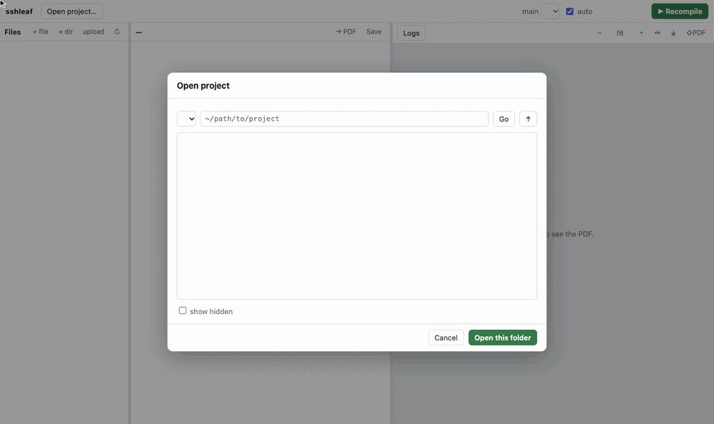

<h1 align="center">sshleaf</h1>

<p align="center">
  <b>A tiny, self-hosted, Overleaf-style LaTeX editor for projects that live on your machine or on any SSH server.</b><br>
  Edit files in place over SSH · compile locally with Tectonic · live PDF preview with SyncTeX
</p>

<p align="center">
  <a href="LICENSE"></a>
  
  
</p>

<p align="center">
  
  <br><sub>30-second demo (<a href="docs/demo.mp4">MP4</a>): open a folder on <code>remote-server</code> over SSH → edit → <kbd>Ctrl</kbd>+<kbd>S</kbd> recompiles locally → click an error to jump to it → double-click the PDF to jump to the source.</sub>
</p>

---

## Why

Your paper's source often sits next to the code and experiments on a remote
machine. Overleaf wants you to upload it to its cloud; VS Code Remote-SSH
compiles on the server, so the server needs a full TeX installation.

**sshleaf** opens any folder on your machine or on any host in
`~/.ssh/config`, edits the files **in place**, and compiles **on your machine**
with [Tectonic](https://tectonic-typesetting.github.io). The server needs
nothing but `ssh` and `rsync`. It runs on `localhost` and opens in your browser.

## Features

- **Local or remote projects:** pick `local` or any host from `~/.ssh/config`, browse to a folder, open it. Recent projects are remembered.
- **Overleaf-like layout:** file tree, editor (CodeMirror, LaTeX highlighting, search, go to line) and a PDF viewer (PDF.js) side by side, with resizable panes.
- **Compile with one key:** <kbd>Ctrl/⌘</kbd>+<kbd>S</kbd> saves and recompiles (toggle "auto"); <kbd>Ctrl/⌘</kbd>+<kbd>Enter</kbd> recompiles. BibTeX and reruns are automatic.
- **Readable errors:** errors and warnings are listed with file and line; click one to jump there. Bad boxes and the full log are collapsed.
- **SyncTeX both ways:** double-click the PDF to jump to the source; <kbd>Ctrl/⌘</kbd>+<kbd>J</kbd> or **→ PDF** highlights the cursor's line in the PDF.
- **Safe with other editors:** saves are rejected if the file changed on disk since you opened it (e.g. edited on the server by you, git, or an AI agent), and you choose which version to keep. Unmodified buffers reload automatically when the window regains focus.
- **File management:** new file/folder, rename/move, upload (drag & drop images onto the tree), set main file. Delete never erases: items move to `<project>/.sshleaf-trash/`.
- **Small:** one Python file for the server and one HTML file for the UI.

## Quick start

Requirements: Python ≥ 3.11 with [uv](https://docs.astral.sh/uv/), [Tectonic](https://tectonic-typesetting.github.io/en-US/install.html), `rsync`, and key-based SSH access to your servers.

```sh
brew install tectonic          # or: see the Tectonic install page for Linux
git clone https://github.com/mayshin10/sshleaf.git
cd sshleaf
uv run sshleaf                 # opens http://127.0.0.1:8765
```

Then click **Open project…** and pick a folder. Try `examples/demo-paper` first.

Options:

```sh
uv run sshleaf --port 9000            # default 8765
uv run sshleaf --no-browser           # don't open a browser tab
uv run sshleaf --ssh-config ./my_cfg  # use another SSH config instead of ~/.ssh/config
```

> The first compile of a new document may take a while: Tectonic downloads the
> LaTeX packages it needs once and caches them.

## Keyboard shortcuts

| Action | Shortcut |
|---|---|
| Save (and recompile if "auto" is on) | <kbd>Ctrl/⌘</kbd>+<kbd>S</kbd> |
| Recompile | <kbd>Ctrl/⌘</kbd>+<kbd>Enter</kbd> |
| Source → PDF | <kbd>Ctrl/⌘</kbd>+<kbd>J</kbd> |
| PDF → source | double-click in the PDF |
| Find / replace | <kbd>Ctrl/⌘</kbd>+<kbd>F</kbd> / <kbd>⌘</kbd>+<kbd>⌥</kbd>+<kbd>F</kbd> (macOS), <kbd>Shift</kbd>+<kbd>Ctrl</kbd>+<kbd>F</kbd> (Linux) |
| Go to line | <kbd>Ctrl/⌘</kbd>+<kbd>L</kbd> |
| Toggle comment | <kbd>Ctrl/⌘</kbd>+<kbd>/</kbd> |

## How it works

```
 browser (127.0.0.1:8765)
   │  edit / save / browse                     compile
   ▼                                              │
 sshleaf server ──── ssh host 'cat / mv …' ───►  project folder (in place)
   │                                              │
   └── rsync host:project/ → ~/.cache/sshleaf/mirror/<id>/
                                   │
                         tectonic -X compile --synctex
                                   │
                     ~/.cache/sshleaf/build/<id>/main.pdf ──► PDF.js viewer
```

- File operations run as plain POSIX shell commands, locally or through
  `ssh` (with connection reuse via `ControlMaster`), so any Linux/macOS host works.
- Saves are atomic (write to a temp file, then `mv`) and carry the hash of the
  version you opened, which is how on-disk conflicts are detected.
- Compiles sync the project into a local mirror with `rsync` and build it with
  Tectonic. The PDF stays in the cache; **⇧PDF** copies it into the project.

State lives in `~/.config/sshleaf/state.json` (recent projects, main file) and
`~/.cache/sshleaf/` (mirrors, builds, SSH control sockets).

## Security

sshleaf is a single-user tool with **no authentication**. It binds to
`127.0.0.1` only, rejects requests whose `Host` is not `127.0.0.1`/`localhost`
(DNS rebinding), and requires a custom header on every API call (cross-site
requests). Do not expose the port to a network. SSH runs with
`BatchMode=yes`, so use keys or an agent; password prompts are not supported.
Shell escape is off when compiling (Tectonic's default).

## Limitations

- One user, no real-time collaboration, no track changes.
- Tectonic (XeTeX engine) only. Most documents work unchanged; packages that need
  `--shell-escape` (e.g. `minted`) do not.
- Remote hosts need a POSIX shell, `rsync`, and key-based SSH.
- SyncTeX positions are best effort (line level).

## Contributing

Issues and pull requests are welcome. The code is intentionally small:
[`sshleaf/server.py`](sshleaf/server.py) (FastAPI backend),
[`sshleaf/synctex.py`](sshleaf/synctex.py) (SyncTeX reader) and
[`sshleaf/static/index.html`](sshleaf/static/index.html) (the whole UI).

```sh
uv run sshleaf --no-browser   # restart after editing server code; the UI reloads on refresh
```

The README demo is reproducible: [`demo/make_demo.sh`](demo/make_demo.sh) starts a
throwaway SSH server (`remote-server`, user `alice`) in Docker, drives sshleaf with
headless Chrome ([`demo/record.py`](demo/record.py)) and re-encodes `docs/demo.*`.

## License

[MIT](LICENSE)
